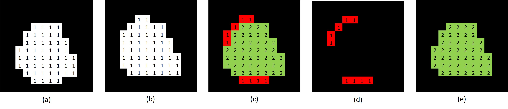

# Inconsistency Masks: Harnessing Model Disagreement for Stable Semi-Supervised Segmentation

Official implementation of the paper "Inconsistency Masks: Harnessing Model Disagreement for Stable Semi-Supervised Segmentation".

Inconsistency Masks (IM) is a stable Semi-Supervised Learning (SSL) framework that reframes model disagreement not as noise to be averaged away, but as a valuable signal for identifying uncertainty. By explicitly filtering inconsistent regions from the training process, IM prevents the "cycle of error propagation" common in continuous self-training loops.

## Creation of an Inconsistency Masks

Creation of an Inconsistency Masks with two models: (a) & (b) binary prediction of model 1 and 2 after threshold, (c) sum of the two prediction masks (d) Inconsistency  Mask (e) final prediction mask

## 🌟 Key Contributions
1.  **General Enhancement Framework:** IM acts as a plug-and-play booster for existing SOTA methods (iMAS, U²PL, UniMatch), consistently improving performance on Cityscapes benchmarks.
2.  **Robustness from Scratch:** In resource-constrained regimes (no pre-trained backbones), IM significantly outperforms standard SSL baselines on diverse domains (Medical, Underwater, Microscopy).
3.  **Dataset Agnostic:** Seamlessly handles binary (ISIC), multi-class (Cityscapes/SUIM), and multi-label (HeLa) segmentation tasks.
4.  **Foundation Model Ready:** Validated on modern **DINOv2** backbones, pushing state-of-the-art results even further.

---

## 📊 Study A: Enhancing SOTA Benchmarks (Cityscapes)

We demonstrate IM's effectiveness as a general performance enhancer. When applied to leading SSL methods, IM consistently boosts accuracy across **ResNet-50** and **DINOv2** backbones.

*   **Codebase:** PyTorch
*   **Protocol:** Standard Cityscapes Semi-Supervised Benchmark (1/16, 1/8, 1/4, 1/2 splits); mIoU on the Cityscapes validation set, mean ± s.d. over 3 runs. Gains of IM in parentheses; * p < 0.05, ** p < 0.01, *** p < 0.001 (paired t-test, n = 3). We thank the authors of [U2PL](https://github.com/Haochen-Wang409/U2PL) for providing these data partitions.

| Method | Backbone | 1/16 Split | 1/8 Split | 1/4 Split | 1/2 Split |
| :--- | :--- | :---: | :---: | :---: | :---: |
| **Standard Architectures** | | | | | |
| Supervised Only | ResNet-50 | 64.53 ± 0.35 | 70.39 ± 0.24 | 73.61 ± 0.56 | 77.82 ± 0.15 |
| **+ IM (Ours)** | ResNet-50 | 71.77 ± 0.80 (+7.24\*\*) | 74.45 ± 0.17 (+4.07\*\*\*) | 77.04 ± 0.79 (+3.43\*\*) | 78.86 ± 0.37 (+1.04\*) |
| U²PL | ResNet-50 | 72.98 ± 0.41 | 75.16 ± 0.24 | 77.71 ± 0.50 | 78.71 ± 0.28 |
| **+ IM (Ours)** | ResNet-50 | 74.84 ± 0.35 (+1.86\*\*) | 76.83 ± 0.19 (+1.68\*) | 78.26 ± 0.43 (+0.55\*) | 79.18 ± 0.24 (+0.47\*\*) |
| UniMatch | ResNet-50 | 74.14 ± 0.59 | 76.70 ± 0.38 | 78.30 ± 0.22 | 79.11 ± 0.13 |
| **+ IM (Ours)** | ResNet-50 | 74.53 ± 0.45 (+0.39) | **77.57 ± 0.17** (+0.87\*) | **78.96 ± 0.35** (+0.66\*) | **79.64 ± 0.08** (+0.53\*\*) |
| iMAS | ResNet-50 | 73.96 ± 0.18 | 76.24 ± 0.36 | 77.93 ± 0.14 | 78.79 ± 0.21 |
| **+ IM (Ours)** | ResNet-50 | **75.20 ± 0.13** (+1.24\*\*) | 77.36 ± 0.21 (+1.11\*\*) | 78.45 ± 0.06 (+0.52\*) | 79.14 ± 0.26 (+0.35\*\*) |
| **Foundation Models** | | | | | |
| UniMatch v2 | DINOv2-S | 80.64 ± 0.10 | 81.59 ± 0.11 | 82.27 ± 0.04 | 82.89 ± 0.10 |
| **+ IM (Ours)** | DINOv2-S | 80.99 ± 0.14 (+0.34\*\*) | 81.89 ± 0.04 (+0.30\*) | 82.61 ± 0.04 (+0.34\*) | 83.15 ± 0.08 (+0.27\*) |
| SegKC | DINOv2-S | 80.33 ± 0.57 | 82.20 ± 0.20 | 82.88 ± 0.17 | 83.09 ± 0.07 |
| **+ IM (Ours)** | DINOv2-S | **81.23 ± 0.34** (+0.90\*) | **82.64 ± 0.15** (+0.44\*\*) | **83.16 ± 0.07** (+0.27\*) | **83.24 ± 0.10** (+0.15) |

---

## 📊 Study B: Resource-Constrained Regimes (Generalization)

We evaluate IM in challenging scenarios: **training entirely from scratch** (random initialization) with only **10% labeled data**. IM significantly outperforms standard SSL baselines, which often suffer from model collapse or stagnation in these regimes.

*   **Codebase:** TensorFlow / Keras
*   **Protocol:** Lightweight `1x1 U-Net` trained from scratch on 10% labeled data.
*   **Datasets:** Medical (ISIC 2018), Microscopy (HeLa), Underwater (SUIM), Urban (Cityscapes).

| Method | ISIC 2018   (IoU ↑) | HeLa   (MCCE ↓) | SUIM   (mIoU ↑) | Cityscapes   (mIoU ↑) |
| :--- | :---: | :---: | :---: | :---: |
| **Reference** | | | | |
| Labeled Only (LDT) | 65.2 ± 1.8 | 12.62 ± 4.29 | 32.8 ± 1.6 | 30.9 ± 1.7 |
| Aug. Labeled (ALDT) | 72.0 ± 0.7 | 3.76 ± 0.77 | 42.5 ± 0.5 | 37.1 ± 0.3 |
| Full Dataset (FDT) | 74.5 ± 0.6 | 2.55 ± 0.08 | 50.6 ± 1.0 | 45.3 ± 0.4 |
| Aug. Full Dataset (AFDT) | 77.1 ± 0.2 | 2.64 ± 0.20 | 51.3 ± 0.5 | 45.6 ± 0.2 |
| **Internal Baselines** | | | | |
| Model Ensemble (ME) | 68.7 ± 0.8 | 5.08 ± 0.90 | 34.6 ± 2.3 | 34.5 ± 0.2 |
| Noisy Student (NS) | 72.4 ± 1.8 | 2.94 ± 0.12 | 42.2 ± 0.9 | 39.8 ± 0.2 |
| **SSL Baselines** | | | | |
| FixMatch | 68.3 ± 2.6 | 43.78 ± 1.26 | 33.3 ± 2.6 | 35.5 ± 1.1 |
| FPL | 62.6 ± 5.7 | 41.96 ± 9.98 | 24.0 ± 3.4 | 13.3 ± 1.9 |
| CrossMatch | 64.8 ± 0.3 | 4.55 ± 1.02 | 35.6 ± 0.2 | 33.2 ± 2.1 |
| iMAS | 63.2 ± 4.0 | 16.43 ± 3.49 | 32.7 ± 1.5 | 35.1 ± 0.1 |
| UPS | 34.6 ± 3.0 | 28.96 ± 4.45 | 22.8 ± 3.5 | – |
| U²PL | 64.2 ± 2.9 | 27.20 ± 5.50 | 35.5 ± 1.0 | 35.4 ± 0.2 |
| UniMatch | 57.7 ± 7.4 | 34.62 ± 23.40 | 25.2 ± 1.2 | 23.3 ± 1.2 |
| **Ours** | | | | |
| IM (Ours) | 71.6 ± 0.6 | 2.99 ± 0.25 | 43.1 ± 1.4 | 40.4 ± 0.3 |
| IM+ (Ours) | 72.7 ± 0.7 | **2.71 ± 0.07** | 44.6 ± 0.7 | 42.3 ± 0.3 |
| IM++ (Ours) | 75.6 ± 0.6 | 2.72 ± 0.17 | 45.7 ± 0.3 | **42.5 ± 0.3** |
| AIM+ (Ours) | 75.0 ± 0.2 | **2.71 ± 0.19** | **47.1 ± 1.0** | 41.0 ± 0.1 |
| AIM++ (Ours) | **76.4 ± 0.6** | 2.82 ± 0.04 | **47.1 ± 1.2** | 42.1 ± 0.4 |

*Mean ± s.d. over 3 runs on the test sets. In each run, the model with the best validation score is selected and its test score is reported; generations and settings are also chosen on the validation set. Best SSL result per dataset in bold. For HeLa, MCCE is the mean cell count error, so lower is better. UPS could not be run on Cityscapes (memory).*

---

🧬 HeLa Dataset

We release the HeLa Multi-Label Dataset used in this study. It features non-mutually exclusive labels for 'alive' cells, 'dead' cells, and 'position' markers.
[[HeLa Dataset](https://drive.google.com/file/d/1JRlgYDcxYdWUhCbLHrTVO8UizLhTnF1W/view)]

## Acknowledgement
I would like to extend my heartfelt gratitude to the Deep Learning and Open Source Community, particularly to Dr. Sreenivas Bhattiprolu (https://www.youtube.com/@DigitalSreeni), Sentdex (https://youtube.com/@sentdex) and Deeplizard (https://www.youtube.com/@deeplizard),  whose tutorials and shared wisdom have been a big part of my self-education in computer science and deep learning. This work would not exist without these open and free resources.  

## Paper
https://arxiv.org/abs/2401.14387