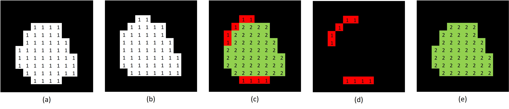

# Inconsistency Masks: Harnessing Model Disagreement for Stable Semi-Supervised Segmentation

Official implementation of the paper "Inconsistency Masks: Harnessing Model Disagreement for Stable Semi-Supervised Segmentation".

Inconsistency Masks (IM) is a stable Semi-Supervised Learning (SSL) framework that reframes model disagreement not as noise to be averaged away, but as a valuable signal for identifying uncertainty. By explicitly filtering inconsistent regions from the training process, IM prevents the "cycle of error propagation" common in continuous self-training loops.

## Creation of an Inconsistency Masks

Creation of an Inconsistency Masks with two models: (a) & (b) binary prediction of model 1 and 2 after threshold, (c) sum of the two prediction masks (d) Inconsistency  Mask (e) final prediction mask

## 🌟 Key Contributions
1.  **General Enhancement Framework:** IM acts as a plug-and-play booster for existing SOTA methods (iMAS, U²PL, UniMatch), consistently improving performance on Cityscapes benchmarks.
2.  **Robustness from Scratch:** In resource-constrained regimes (no pre-trained backbones), IM significantly outperforms standard SSL baselines on diverse domains (Medical, Underwater, Microscopy).
3.  **Dataset Agnostic:** Seamlessly handles binary (ISIC), multi-class (Cityscapes/SUIM), and multi-label (HeLa) segmentation tasks.
4.  **Foundation Model Ready:** Validated on modern **DINOv2** backbones, pushing state-of-the-art results even further.

---

## 📊 Study A: Enhancing SOTA Benchmarks (Cityscapes)

We demonstrate IM's effectiveness as a general performance enhancer. When applied to leading SSL methods, IM consistently boosts accuracy across **ResNet-50** and **DINOv2** backbones.

*   **Codebase:** TensorFlow
*   **Protocol:** Standard Cityscapes Semi-Supervised Benchmark (1/16, 1/8, 1/4, 1/2 splits). We thank the authors of [U2PL](https://github.com/Haochen-Wang409/U2PL) for providing these data partitions.

| Method | Backbone | 1/16 Split | 1/8 Split | 1/4 Split | 1/2 Split |
| :--- | :--- | :---: | :---: | :---: | :---: |
| **Standard Architectures** | | | | | |
| Supervised Only | ResNet-50 | 64.93 | 70.20 | 74.22 | 77.65 |
| **+ IM (Ours)** | **ResNet-50** | **72.53** *(+7.60)* | **74.47** *(+4.27)* | **77.95** *(+3.73)* | **78.78** *(+1.13)* |
| U²PL | ResNet-50 | 72.53 | 74.89 | 77.16 | 78.39 |
| **+ IM (Ours)** | **ResNet-50** | **74.52** *(+1.99)* | **76.90** *(+2.01)* | **77.77** *(+0.61)* | **78.91** *(+0.52)* |
| UniMatch | ResNet-50 | 73.49 | 76.26 | 78.05 | 79.05 |
| **+ IM (Ours)** | **ResNet-50** | **74.10** *(+0.61)* | **77.38** *(+1.12)* | **78.58** *(+0.53)* | **79.60** *(+0.55)* |
| iMAS | ResNet-50 | 74.07 | 76.32 | 77.80 | 79.01 |
| **+ IM (Ours)** | **ResNet-50** | **75.15** *(+1.08)* | **77.45** *(+1.13)* | **78.43** *(+0.63)* | **79.41** *(+0.40)* |
| **Foundation Models** | | | | | |
| UniMatch v2 | DINOv2-S | 80.67 | 81.71 | 82.32 | 82.84 |
| **+ IM (Ours)** | **DINOv2-S** | **80.97** *(+0.30)* | **81.93** *(+0.22)* | **82.59** *(+0.27)* | **83.07** *(+0.23)* |
| SegKC | DINOv2-S | 80.98 | 82.43 | 82.87 | 83.05 |
| **+ IM (Ours)** | **DINOv2-S** | **81.61** *(+0.63)* | **82.80** *(+0.37)* | **83.14** *(+0.27)* | **83.31** *(+0.26)* |

---

## 📊 Study B: Resource-Constrained Regimes (Generalization)

We evaluate IM in challenging scenarios: **training entirely from scratch** (random initialization) with only **10% labeled data**. IM significantly outperforms standard SSL baselines, which often suffer from model collapse or stagnation in these regimes.

*   **Codebase:** PyTorch
*   **Protocol:** Lightweight `1x1 U-Net` trained from scratch on 10% labeled data.
*   **Datasets:** Medical (ISIC 2018), Microscopy (HeLa), Underwater (SUIM), Urban (Cityscapes).

| Method | ISIC 2018   (IoU ↑) | HeLa   (MCCE ↓) | SUIM   (mIoU ↑) | Cityscapes   (mIoU ↑) |
| :--- | :--- | :--- | :--- | :--- |
| **Reference** | | | | |
| Labeled Only (LDT) | 67.1 | 9.9 | 35.7 | 32.0 |
| Aug. Labeled (ALDT) | 72.4 | 3.3 | 43.2 | 37.4 |
| Full Dataset (FDT) | 75.1 | 2.5 | 51.7 | 45.6 |
| Aug. Full Dataset (AFDT) | 77.3 | 2.4 | 52.7 | 45.8 |
| **SOTA Baselines** | | | | |
| FixMatch | 70.3 | 42.6 | 36.1 | 36.6 |
| FPL | 68.4 | 30.6 | 25.7 | 15.2 |
| CrossMatch | 65.7 | 3.6 | 36.5 | 34.7 |
| iMAS | 66.1 | 13.8 | 33.7 | 35.2 |
| U²PL | 67.5 | 22.6 | 36.6 | 35.5 |
| UniMatch | 64.0 | 7.7 | 26.5 | 24.3 |
| **Ours** | | | | |
| Model Ensemble (ME) | 69.0 | 3.9 | 37.1 | 35.0 |
| **IM (Ours)** | **72.3** | **2.8** | **44.3** | **40.7** |

*(Note: For HeLa, MCCE represents cell count error, so lower is better.)*

---

🧬 HeLa Dataset

We release the HeLa Multi-Label Dataset used in this study. It features non-mutually exclusive labels for 'alive' cells, 'dead' cells, and 'position' markers.
[[HeLa Dataset](https://drive.google.com/file/d/1JRlgYDcxYdWUhCbLHrTVO8UizLhTnF1W/view)]

## Acknowledgement
I would like to extend my heartfelt gratitude to the Deep Learning and Open Source Community, particularly to Dr. Sreenivas Bhattiprolu (https://www.youtube.com/@DigitalSreeni), Sentdex (https://youtube.com/@sentdex) and Deeplizard (https://www.youtube.com/@deeplizard),  whose tutorials and shared wisdom have been a big part of my self-education in computer science and deep learning. This work would not exist without these open and free resources.  

## Paper
https://arxiv.org/abs/2401.14387

